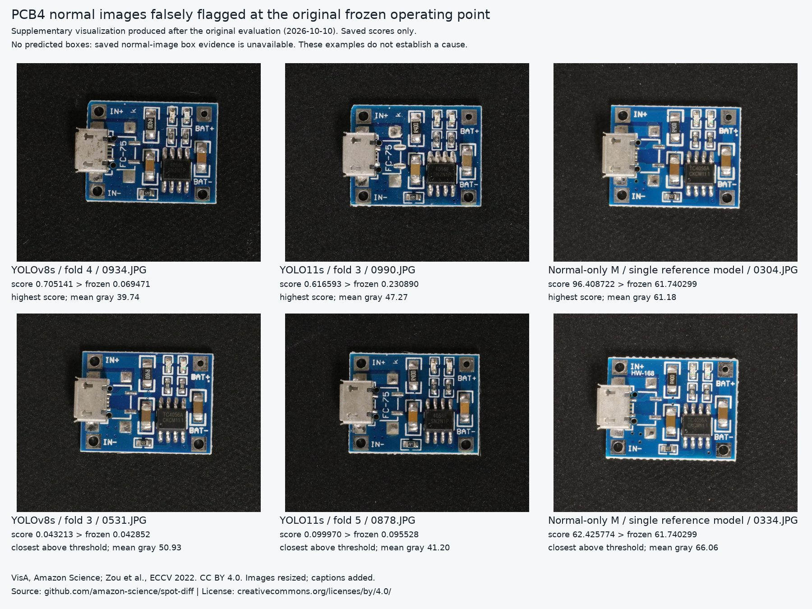

# PCB4 false-alarm visualization supplement

**Supplementary visualization produced after the original evaluation, 2026-10-10.**
The original false-alarm contact sheet was missing; that historical disclosure is preserved in `AUDIT.md` §11.

The six examples are normal images in the recorded TEST-N partition. For each of YOLOv8s, YOLO11s and
normal-only M, the sheet shows the highest saved false-alarm score and a different image with the smallest
positive score-minus-threshold margin. Selection is across the five YOLO folds within each architecture;
this is an illustrative selection, not an unbiased sample or a comparison of score scales across models.
The image identifier, model/fold, recorded score and corresponding frozen threshold appear on every panel.

`make_false_alarm_supplement.py` verifies the 144th CALIB order statistic against the recorded audit threshold,
the strict `score > threshold` rule, normal labels, TEST-N roles and original image SHA-256 values. It reads
existing scores and local images only; it runs no model and changes no predictions or operating point.
`false_alarm_supplement.json` records source CSVs, exact scores, thresholds, image hashes, selection and figure hash.

No boxes or heat maps are drawn. Saved predicted-box evidence covers defect images, not these normal images.
The diagnostic value is a readable view of genuinely flagged normal boards at both large and small margins,
with unmodified image brightness and its mean gray level. These examples do not identify the triggering region,
establish a cause, estimate prevalence or prove a brightness shortcut.

Images: VisA, Amazon Science; Zou et al., *SPot-the-Difference Self-Supervised Pre-training for Anomaly Detection
and Segmentation*, ECCV 2022. [Source](https://github.com/amazon-science/spot-diff),
[CC BY 4.0](https://creativecommons.org/licenses/by/4.0/). Changes: downscaling and added captions; no endorsement.
The named JPEG is allowed by `ivad check` C7 with a 500,000-byte cap and is listed in `NOTICE.md`.
